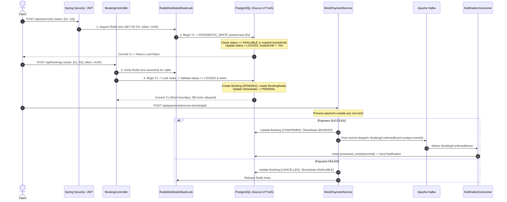
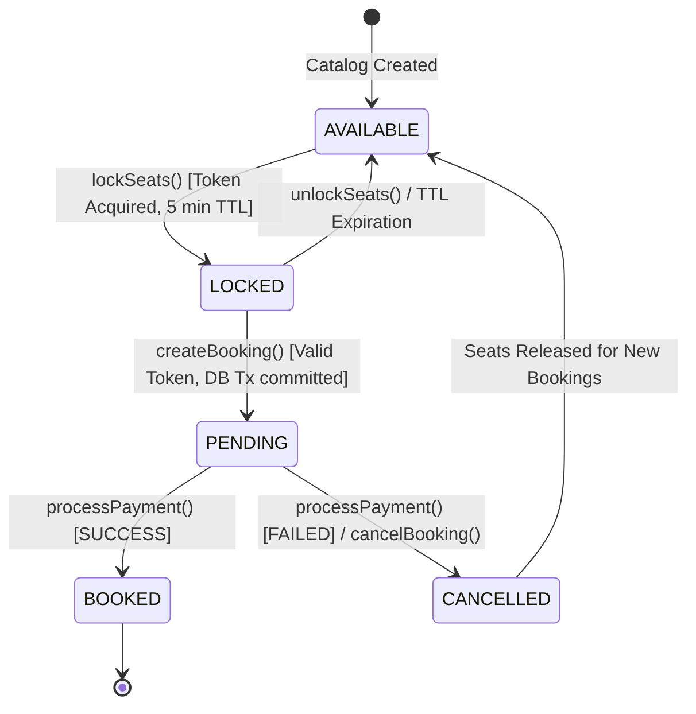

# High-Concurrency Ticket Booking System

[](https://openjdk.org/projects/jdk/21/)
[](https://spring.io/projects/spring-boot)
[](https://react.dev/)
[](https://vitejs.dev/)
[](https://www.postgresql.org/)
[](https://redis.io/)
[](https://kafka.apache.org/)
[](https://www.docker.com/)
[]()

A production-grade, highly concurrent ticket reservation engine and full-stack web application (BookMyShow / Ticketmaster architecture) built with a Spring Boot 3 modular monolith backend (Java 21, PostgreSQL, Redis, Kafka) and an interactive, responsive **CineBook** frontend (React 18, Vite).

The system guarantees **zero double bookings**, **zero partial reservations**, and uses **deterministic lock ordering to prevent circular-wait deadlocks** under aggressive multi-threaded contention by coordinating an ephemeral **Redis distributed lock** layer, **PostgreSQL row-level pessimistic locking** (`SELECT ... FOR UPDATE`), and relational database constraints. Asynchronous notifications are driven through **Apache Kafka** with strict consumer-side idempotency and short transaction boundaries.

---

## Table of Contents
- [The Problem: Why Naive CRUD Booking Fails](#the-problem-why-naive-crud-booking-fails)
- [System Architecture](#system-architecture)
- [Three-Tier Concurrency Protection Model](#three-tier-concurrency-protection-model)
- [Deterministic Deadlock Prevention](#deterministic-deadlock-prevention)
- [Booking Lifecycle & State Machine](#booking-lifecycle--state-machine)
- [Short Transaction Boundaries & Mock Payment Flow](#short-transaction-boundaries--mock-payment-flow)
- [Kafka Event-Driven Notifications & Idempotency](#kafka-event-driven-notifications--idempotency)
- [Architectural Trade-Off: Post-Commit Publishing vs. Transactional Outbox](#architectural-trade-off-post-commit-publishing-vs-transactional-outbox)
- [JWT Authentication & Security Model](#jwt-authentication--security-model)
- [High-Concurrency & Edge-Case Test Suite (44 Tests)](#high-concurrency--edge-case-test-suite-44-tests)
- [Technology Stack](#technology-stack)
- [Quickstart: Running with Docker Compose](#quickstart-running-with-docker-compose)
- [Running Locally for Development](#running-locally-for-development)
- [API Reference & Swagger UI](#api-reference--swagger-ui)
- [Resume-Ready Bullet Points](#resume-ready-bullet-points)

---

## The Problem: Why Naive CRUD Booking Fails

In high-demand ticketing scenarios (e.g., concert drops, flash sales, blockbuster movie premieres), thousands of users simultaneously compete for the exact same inventory:

1. **The "Check-Then-Act" Race Condition**:
   Standard CRUD controllers perform:
   ```sql
   -- User A and User B execute concurrently:
   SELECT status FROM show_seats WHERE id = :seatId; -- Both read 'AVAILABLE'
   UPDATE show_seats SET status = 'BOOKED' WHERE id = :seatId; -- Both succeed, causing a double booking!
   ```
2. **Cascade Deadlocks in Multi-Seat Reservations**:
   When User A requests seats `[Seat 1, Seat 2]` while User B requests `[Seat 2, Seat 1]`, naive queries acquire database locks in arbitrary order, causing PostgreSQL deadlock aborts (`40P01`).
3. **Application Memory Locks Fail Across Instances**:
   Java-level synchronizers (`synchronized`, `ReentrantLock`) only synchronize a single JVM. In a clustered deployment with multiple app replicas, cross-instance concurrency is completely uncoordinated.
4. **Long-Running Payment Lock Poisoning**:
   Holding database connection locks while waiting for third-party payment gateways (2–30 seconds) starves the connection pool (`HikariCP`), degrading throughput and causing system-wide timeouts.

---

## System Architecture

The project is structured as a **Modular Monolith** with clear architectural boundaries between catalog discovery, distributed locking, booking orchestration, payment processing, security, and event streaming.

```
+---------------------------------------------------------------------------------------------------+
|                                            CLIENT LAYER                                           |
|                           Web / Mobile Apps / Load Balancers / API Clients                        |
+---------------------------------------------------------------------------------------------------+
                                                  |  HTTP (Bearer JWT)
                                                  v
+---------------------------------------------------------------------------------------------------+
|                                         SPRING SECURITY                                           |
|                  JwtAuthenticationFilter -> SecurityUtils (User Context & Ownership)             |
+---------------------------------------------------------------------------------------------------+
                                                  |
                                                  v
+---------------------------------------------------------------------------------------------------+
|                                         REST CONTROLLERS                                          |
|                AuthController | CatalogControllers | SeatLockController | BookingController       |
+---------------------------------------------------------------------------------------------------+
                                                  |
                                                  v
+---------------------------------------------------------------------------------------------------+
|                                          SERVICE LAYER                                            |
|                                                                                                   |
|   +-----------------------+     +------------------------+     +------------------------------+   |
|   |    SeatLockService    |     |     BookingService     |     |      MockPaymentService      |   |
|   +-----------------------+     +------------------------+     +------------------------------+   |
|               |                             |                                 |                   |
+---------------|-----------------------------|---------------------------------|-------------------+
                |                             |                                 |
         [Layer 1: Redis]              [Layer 2: DB Lock]                 [Microsecond Tx]
                v                             v                                 v
+------------------------------+ +------------------------------+ +---------------------------------+
|      REDIS DISTRIBUTED LOCK   | |     POSTGRESQL DATABASE      | |       POST-COMMIT DISPATCH      |
|                              | | (AUTHORITATIVE SOURCE)       | |                                 |
| - SET NX EX (5 min TTL)      | | - PESSIMISTIC_WRITE Lock     | | - Transaction commits           |
| - UUID Token Ownership       | | - Deterministic ID Sorting   | | - Kafka BookingConfirmedEvent   |
| - Atomic Lua Script Release  | | - Short Transaction Scope    | | - Idempotent Consumer (DB log)  |
+------------------------------+ +------------------------------+ +---------------------------------+
```

### Complete End-to-End Execution Flow



---

## Three-Tier Concurrency Protection Model

The system enforces a **defense-in-depth concurrency model**. No single layer is solely trusted:

```
+----------------------------------------------------------------------------------+
| LAYER 1: REDIS DISTRIBUTED LOCK (Memory Layer)                                   |
| - Rapidly rejects 99%+ of competing concurrent threads in-memory before DB load. |
| - SET seat_lock:{showId}:{seatId} {lockToken} NX EX 300                          |
| - Atomic Lua release ensures User A cannot release User B's lock.                |
+----------------------------------------------------------------------------------+
                                        v (Passed Layer 1)
+----------------------------------------------------------------------------------+
| LAYER 2: POSTGRESQL PESSIMISTIC LOCKING (Transactional Layer)                    |
| - Authoritative Source of Truth.                                                 |
| - SELECT ... FOR UPDATE via @Lock(LockModeType.PESSIMISTIC_WRITE).               |
| - Sorted lexicographical seat IDs guarantee single-winner execution.             |
| - Validates seat status and lockToken consistency.                               |
+----------------------------------------------------------------------------------+
                                        v (Passed Layer 2)
+----------------------------------------------------------------------------------+
| LAYER 3: RELATIONAL DATABASE UNIQUE CONSTRAINTS (Storage Fallback)               |
| - uq_booking_show_seat on (booking_id, show_seat_id) prevents duplicate entries. |
| - uq_show_seat on (show_id, seat_id) guarantees physical slot uniqueness.        |
| - uq_processed_events_event_id prevents duplicate Kafka event processing.        |
+----------------------------------------------------------------------------------+
```

### Why Relying Only on Redis is Unsafe:
1. **Network partitions and GC pauses**: If a JVM thread pauses for longer than the Redis TTL, Redis automatically expires the lock. A second thread acquires it. Without PostgreSQL row locking, both threads would execute concurrent database writes.
2. **Redis Failover / Split-Brain**: During an unacknowledged Redis master failover, newly acquired locks can be lost if replication lag exists. PostgreSQL must remain the durable, transactional source of truth.

### Why Relying Only on PostgreSQL is Unsafe:
1. **Thundering Herd Connection Exhaustion**: 10,000 concurrent requests all executing `SELECT ... FOR UPDATE` directly on PostgreSQL would instantly exhaust database connection pools and spike CPU utilization to 100%. Redis acts as an ultra-fast in-memory filter shedding invalid traffic in sub-milliseconds.

---

## Deterministic Deadlock Prevention

When locking multiple seats (e.g., a family reserving seats 5, 6, and 7), concurrent requests can deadlock if they acquire locks in differing order.

**Solution: Deterministic Lexicographical Sorting**:
Every multi-seat operation sorts seat IDs before acquiring both Redis and PostgreSQL locks:
```java
List<UUID> sortedSeatIds = seatIds.stream().sorted().toList();
```
Because all threads acquire locks in the exact same mathematical order, **circular wait is eliminated**, preventing circular-wait deadlocks across the entire system.

---

## Booking Lifecycle & State Machine



### Expiration Race Resolution (Redis vs. PostgreSQL)
- **Redis Lock TTL**: 300 seconds (`SEAT_LOCK_TTL_SECONDS`).
- **PostgreSQL `locked_until`**: `Instant.now().plusSeconds(300)`.
- **Authoritative Rule**: PostgreSQL is the final source of truth. If the Redis key expires prematurely, PostgreSQL checks `lockedUntil.isBefore(Instant.now())`. If expired, it safely re-locks the seat. If Redis retains the lock while PostgreSQL lock expired, a re-locking thread must successfully acquire the Redis key before PostgreSQL will grant the reservation.

---

## Short Transaction Boundaries & Mock Payment Flow

A major anti-pattern in high-concurrency systems is holding database locks during external payment gateway interactions.

### Architecture Decision:
1. `BookingService.createBooking()` acquires row locks, sets booking status to `PENDING`, and **immediately commits the database transaction**, keeping row lock hold times strictly confined to the immediate database state transition before any payment processing begins.
2. `MockPaymentService.processPayment()` simulates external gateway latency (mocked or external API) **completely outside of any database lock**.
3. Upon payment resolution, a new, fast transaction executes:
   - **Payment Success**: Updates booking to `CONFIRMED`, seats to `BOOKED`, and dispatches Kafka confirmation event.
   - **Payment Failure**: Updates booking to `CANCELLED`, automatically releases show seats back to `AVAILABLE`, and releases any lingering Redis locks.

---

## Kafka Event-Driven Notifications & Idempotency

When a booking is confirmed, downstream services (Email, SMS, WhatsApp notifications) must be informed without introducing synchronous HTTP coupling or blocking payment execution.

```
+-------------------+      After Commit       +-------------------+
|  Payment Service  | ----------------------> |    Apache Kafka   |
| (Committed in DB) |                         |  booking-events   |
+-------------------+                         +-------------------+
                                                        |
                                                        v (At-Least-Once Delivery)
                                              +-------------------+
                                              |   Notification    |
                                              |     Consumer      |
                                              +-------------------+
                                                        |
                                       +----------------+----------------+
                                       |                                 |
                                       v                                 v
                             [Check ProcessedEvent]             [Duplicate Detected]
                             INSERT INTO processed_events        DataIntegrityViolationException
                             (event_id, processed_at)            -> Safe ACK, No Duplicate Sent!
```

### Consumer Idempotency Guarantee
Kafka guarantees **at-least-once delivery**, meaning duplicate messages can arrive during network rebalances.
- Every `BookingConfirmedEvent` carries a unique `eventId` (UUID).
- The `NotificationConsumer` attempts to insert the `eventId` into the `processed_events` table (enforced with a database `UNIQUE` constraint).
- If the event was already handled, PostgreSQL throws a `DataIntegrityViolationException`. The consumer logs the duplicate and acknowledges the Kafka offset without duplicate notification delivery or consumer failure.

---

## Architectural Trade-Off: Post-Commit Publishing vs. Transactional Outbox

This system intentionally employs **Post-Commit Kafka Event Publishing** (`@TransactionalEventListener(phase = AFTER_COMMIT)` / Spring Kafka post-commit):

### The Trade-Off Analyzed:
- **Failure Isolation Benefit**: If Apache Kafka brokers experience an outage, network partition, or disk saturation, the database booking transaction has already committed. Customers **never lose their confirmed booking** due to a notification broker failure.
- **Event-Loss Risk**: If the application server crashes or loses power in the microsecond window between PostgreSQL transaction commit and Kafka network dispatch, the event will not be published.

### Production Evolution: Transactional Outbox Pattern
For financial systems requiring strict zero-loss event guarantees, the **Transactional Outbox Pattern** is the recommended evolution:
1. Save the event directly into an `outbox` table in the same local database transaction as the booking.
2. A separate Debezium Change Data Capture (CDC) connector or polling background worker reads the outbox table and streams events into Kafka with guaranteed zero loss.

---

## JWT Authentication & Security Model

The system implements **stateless JWT-based authentication** using Spring Security 6:
- **Password Security**: BCrypt password hashing (never plaintext).
- **Public Endpoints**: `/api/auth/**`, `/swagger-ui/**`, `/v3/api-docs/**`, and read-only catalog browsing (`/api/movies/**`, `/api/shows/**`, `/api/venues/**`).
- **Role-Based Authorization**:
  - `ROLE_USER`: Can lock seats, create bookings, process payments, view and cancel own bookings.
  - `ROLE_ADMIN`: Full access to create/update movies, venues, screens, and shows.
- **Cross-User Protection**: `SecurityUtils` verifies the authenticated subject from the JWT claims against requested resource owners. User A cannot view, cancel, pay for, or unlock User B's bookings.

---

## High-Concurrency & Edge-Case Test Suite (44 Tests)

The system includes a comprehensive integration test suite covering stress conditions, concurrent races, and edge-case lifecycle transitions.

| Test Class | Tests | Key Scenarios Covered |
| :--- | :---: | :--- |
| **`HighConcurrencyRaceConditionTest`** | 3 | **100 concurrent threads racing for 1 seat**: exactly 1 succeeds, 99 rejected cleanly, 0 deadlocks.<br>**60 threads competing for overlapping seat pairs** `[A, B], [B, C], [A, C]`: deterministic lock ordering prevents circular-wait deadlocks, exactly 1 pair succeeds.<br>**30 concurrent threads Redis lock race**: atomic rollback prevents partial allocations. |
| **`PessimisticLockingConcurrencyTest`** | 1 | **50 concurrent threads racing for the same seat**: validates PostgreSQL row locking isolation. |
| **`LifecycleAndStateTransitionEdgeCaseTest`** | 8 | Re-booking cancelled seats, state machine transitions, Redis vs DB lock expiry races, concurrent payment/cancellation race, payment idempotency, failure rollback to `AVAILABLE`, atomic rollback on invalid seat IDs. |
| **`SecurityIntegrationTest`** | 17 | Authentication, password hashing, expired/invalid tokens, cross-user authorization enforcement, role privilege checks. |
| **`SeatLockIntegrationTest`** | 6 | Lock acquisition, token validation, wrong token rejection, lock expiration, multi-seat locking, User B unlock prevention. |
| **`BookingFlowIntegrationTest`** | 1 | End-to-end booking flow, seat status transitions, cancellation and re-availability verification. |
| **`MockPaymentIntegrationTest`** | 3 | Payment success transitions, payment failure automatic seat release, double payment prevention. |
| **`NotificationEventIntegrationTest`** | 3 | Kafka notification publishing, consumer idempotency against duplicate delivery, 10-thread concurrent duplicate event race deduplication. |
| **`CatalogCrudIntegrationTest`** | 1 | End-to-end catalog setup (movies, venues, screens, seats, shows) and validation. |
| **`TicketBookingApplicationTests`** | 1 | Spring application context startup validation. |

**Total Test Count**: **44 Tests, 0 Failures, 0 Errors, 0 Skipped.**

---

## Technology Stack

### Backend & Infrastructure
| Component | Technology | Version | Purpose |
| :--- | :--- | :--- | :--- |
| **Language** | Java | 21 (LTS) | Virtual threads ready, modern pattern matching, records |
| **Framework** | Spring Boot | 3.3.4 | Core framework, dependency injection, lifecycle |
| **Persistence** | Spring Data JPA / Hibernate | 6.5.x | ORM, pessimistic locking (`SELECT ... FOR UPDATE`) |
| **Primary Database** | PostgreSQL | 16 | Durable transactional source of truth |
| **Distributed Lock** | Redis / Lettuce | 7 | Low-latency in-memory distributed locks (`SET NX EX`) |
| **Event Streaming** | Apache Kafka / Spring Kafka | 3.7 (KRaft) | Asynchronous post-commit event publishing |
| **Security** | Spring Security & JJWT | 6.x / 0.12.6 | Stateless JWT authentication & role authorization |
| **Documentation** | SpringDoc OpenAPI | 2.6.0 | Swagger UI and OpenAPI 3 schema generation |
| **Containerization** | Docker & Docker Compose | Multi-stage | Production deployment with Alpine runtime |

### Frontend Application (CineBook)
| Component | Technology | Version | Purpose |
| :--- | :--- | :--- | :--- |
| **UI Library** | React | 18.3 | Declarative component UI and reactive state |
| **Build Tool** | Vite | 8.3 | Ultra-fast bundling, HMR, and development proxy |
| **Routing** | React Router DOM | 6.22 | Client-side routing with protected route guards |
| **State Management** | React Context API | Built-in | Global JWT authentication and user session state |
| **Styling** | Dark Cinema CSS3 | Custom | Mobile-responsive (320px–1200px+), accessible WCAG AAA contrast |

---

## Quickstart: Running with Docker Compose

### Prerequisites
- Docker Engine 24.0+ and Docker Compose v2.0+

### 1. Clone & Configure Environment
```bash
git clone https://github.com/your-username/high-concurrency-ticket-booking.git
cd high-concurrency-ticket-booking
cp .env.example .env
```

### 2. Launch the Entire Stack
```bash
docker compose up --build -d
```

This starts:
- **`ticket-booking-postgres`**: PostgreSQL 16 on port `5432` (with healthcheck)
- **`ticket-booking-redis`**: Redis 7 on port `6379` (with healthcheck)
- **`ticket-booking-kafka`**: Apache Kafka in KRaft mode on port `9092` (with healthcheck)
- **`ticket-booking-app`**: Spring Boot application on port `8080` (starts once all backing services are healthy)

### 3. Verify Health & Logs
```bash
docker compose ps
docker compose logs -f app
```

### 4. Stop the Stack
```bash
docker compose down -v
```

---

## Running Locally for Development

### Prerequisites
- **Java 21 JDK** (`export JAVA_HOME=/usr/lib/jvm/java-21-openjdk`)
- **Maven 3.9+**
- **Node.js 18+ & npm**
- **Backing Services**: PostgreSQL (5432), Redis (6379), and Kafka (9092) running locally or started via Docker:
  ```bash
  docker compose up -d postgres redis kafka
  ```

### 1. Build and Run All Backend Tests
```bash
export JAVA_HOME=/usr/lib/jvm/java-21-openjdk
mvn clean test
```
*Expected: 44 tests run, 0 failures, 0 errors, 0 skipped.*

### 2. Start Backend Locally
```bash
export JAVA_HOME=/usr/lib/jvm/java-21-openjdk
mvn spring-boot:run
```
*The Spring Boot backend will listen on `http://localhost:8080`.*

### 3. Start CineBook Frontend Locally
In a separate terminal:
```bash
cd frontend
npm install
npm run dev
```
*The Vite development server will listen on `http://localhost:5173` and proxy `/api` requests directly to `http://localhost:8080`.*

### 4. Build Frontend for Production
```bash
cd frontend
npm run build
```
*Builds optimized, minified production assets into `frontend/dist/` in ~250ms.*

---

## Honest Payment UX & Transactional Booking Contract

In this application:
- **`POST /api/bookings`** is the authoritative, transactional reservation endpoint. It validates caller identity, verifies the Redis lock token, applies PostgreSQL pessimistic row locks (`SELECT FOR UPDATE`), transitions seats to `BOOKED`, clears the Redis lock, and permanently confirms the reservation in the database.
- **Mock Payment Interface**: The frontend displays simulated payment options (Credit Card / UPI) to demonstrate an end-to-end cinema checkout experience. These are demonstrational; no live credit card gateway transaction or financial charge occurs.
- **Short Transaction Boundary**: In the backend's optional 2-phase payment flow (`MockPaymentService.processPayment`), third-party gateway interactions execute strictly outside of database row locks, preventing connection pool exhaustion during external network latency.

---

## API Reference & Swagger UI

Interactive Swagger documentation is available at:
```
http://localhost:8080/swagger-ui.html
```
Raw OpenAPI 3 JSON specification:
```
http://localhost:8080/v3/api-docs
```

### Core API Endpoints

| Category | Method | Endpoint | Access | Description |
| :--- | :--- | :--- | :--- | :--- |
| **Auth** | `POST` | `/api/auth/register` | Public | Register new user account |
| **Auth** | `POST` | `/api/auth/login` | Public | Login and obtain JWT Bearer token |
| **Catalog** | `GET` | `/api/movies` | Public | Browse movies |
| **Catalog** | `POST` | `/api/movies` | Admin | Create new movie |
| **Catalog** | `GET` | `/api/shows` | Public | Browse scheduled shows |
| **Catalog** | `GET` | `/api/shows/movie/{movieId}` | Public | Browse shows for a specific movie |
| **Catalog** | `GET` | `/api/shows/{id}/seats` | Public | View seats and real-time availability |
| **Locks** | `POST` | `/api/seat-locks` | User | Acquire 5-minute Redis distributed lock |
| **Locks** | `DELETE` | `/api/seat-locks` | User | Release seat lock with lock token |
| **Bookings**| `POST` | `/api/bookings` | User | Create booking using valid lock token |
| **Bookings**| `GET` | `/api/bookings/{id}` | User (Owner) | View booking details |
| **Bookings**| `GET` | `/api/bookings/my-bookings` | User | View all bookings for authenticated user |
| **Bookings**| `POST` | `/api/bookings/{id}/cancel` | User (Owner) | Cancel booking and release seats |
| **Payments**| `POST` | `/api/payments/process` | User (Owner) | Process payment (SUCCESS / FAILED) |

---

