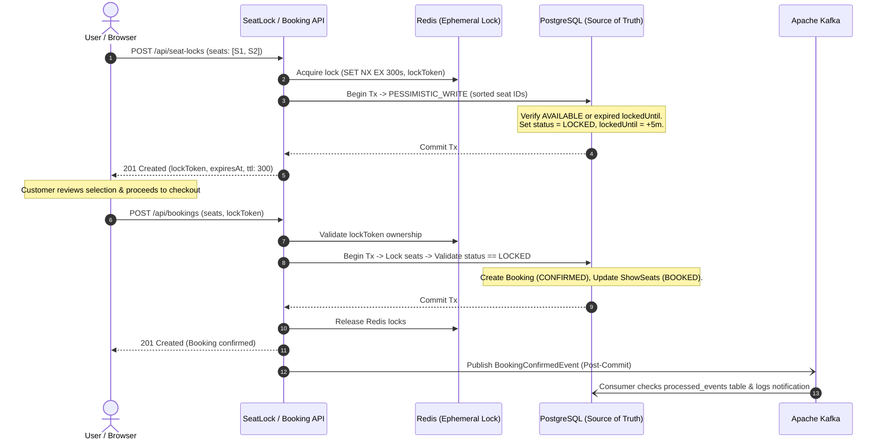

# CineBook — High-Concurrency Ticket Booking System

A high-concurrency cinema ticket reservation platform built with a **Spring Boot 3** modular monolith backend (Java 21, PostgreSQL, Redis, Apache Kafka) and a responsive **CineBook** frontend (React 18, Vite).

The system prevents double-bookings, partial allocations, and circular-wait deadlocks under heavy concurrent traffic by coordinating ephemeral **Redis distributed locks**, **PostgreSQL pessimistic row locking** (`SELECT ... FOR UPDATE`), and relational constraints.

---

## Key Features

- **Multi-Tier Concurrency Protection**: Ephemeral Redis distributed locking (`SET NX EX`) combined with PostgreSQL row-level pessimistic locking (`PESSIMISTIC_WRITE`) and relational unique constraints.
- **Deterministic Deadlock Prevention**: Lexicographical seat-ID sorting before lock acquisition eliminates circular wait across multi-seat reservations.
- **5-Minute Ephemeral Seat Locks**: Live interactive countdown timer holding temporary seat reservations while customers review their order.
- **Stateless JWT Authentication**: Secure role-based access control (`ROLE_USER`, `ROLE_ADMIN`) with strict resource ownership validation.
- **Asynchronous Event Notifications**: Post-commit event publishing to Apache Kafka with consumer-side deduplication table (`processed_events`).
- **Responsive Dark Neo-Brutalist Frontend**: High-contrast dark cinema aesthetic, confident typography, distinct seat status visual indicators, and mobile-friendly viewports (320px+).

---

## Technology Stack

| Layer | Technology | Version | Purpose |
| :--- | :--- | :--- | :--- |
| **Language** | Java | 21 (LTS) | Backend runtime, records, pattern matching |
| **Framework** | Spring Boot | 3.3.4 | Web API, dependency injection, transaction management |
| **Persistence** | Spring Data JPA / Hibernate | 6.5.x | ORM, pessimistic row locks (`SELECT ... FOR UPDATE`) |
| **Database** | PostgreSQL | 16 | ACID source of truth, relational integrity |
| **Distributed Lock** | Redis / Lettuce | 7 | Low-latency in-memory seat locks (`SET NX EX`) |
| **Message Broker** | Apache Kafka | 3.7 (KRaft) | Asynchronous event streaming and notification dispatch |
| **Security** | Spring Security & JJWT | 6.x / 0.12.6 | Stateless JWT authentication, role guards |
| **API Docs** | SpringDoc OpenAPI | 2.6.0 | Swagger UI and OpenAPI 3 specifications |
| **Frontend UI** | React | 18.3 | Declarative components, reactive reservation state |
| **Bundler** | Vite | 8.3 | Fast build tool and dev proxy |
| **Styling** | Vanilla CSS3 | Custom | Dark Neo-brutalist cinema aesthetic, fully responsive |
| **Containerization**| Docker & Docker Compose | Compose v2 | Multi-container stack orchestration |

---

## Frontend Design & User Experience

The CineBook frontend adheres to a **restrained dark Neo-brutalist** design system:
- Near-black backgrounds (`#0a0a0f`), charcoal cards (`#14141c`), confident typography, and cinema-red accents (`#e50914`).
- **Cinematic Hero**: Presents the core reservation message:
  - Label: `YOUR NEXT MOVIE NIGHT`
  - Headline: `YOUR SEAT. YOUR SHOW. YOUR NIGHT.`
  - Subtitle: *Discover movies, find your showtime, and book your favourite seat.*
  - Action: **EXPLORE MOVIES** quick-navigation button.
- **Seat Map**: Interactive seat grid clearly distinguishing available, selected, locked, and booked seats with accessible labels and keyboard accessibility.
- **Live Reservation Timer**: Real-time 5-minute countdown synchronized with Redis distributed lock TTL.
- **Honest Payment UX**: The checkout payment options (Credit Card / UPI) are demonstrational to complete the cinema reservation experience. No live financial transaction occurs.

---

## Architecture & Concurrency Model

```
[ Client: Web / Mobile ]
           |  HTTP + Bearer JWT
           v
[ Spring Security Filter Chain ]
           |
           v
[ Rest Controllers ]
    - AuthController
    - CatalogControllers (Movies, Venues, Shows)
    - SeatLockController
    - BookingController
           |
           v
[ Service Layer ]
    +-------------------------------------------------------------------+
    | Layer 1: Redis Distributed Lock (SET NX EX, 5-min TTL, Lock Token) |
    |   -> Fast in-memory rejection of competing concurrent requests     |
    +-------------------------------------------------------------------+
           |
           v
    +-------------------------------------------------------------------+
    | Layer 2: PostgreSQL Pessimistic Write Lock (SELECT FOR UPDATE)    |
    |   -> Lexicographical seat-ID sorting prevents circular deadlocks  |
    |   -> Authoritative validation of seat availability & lock token   |
    +-------------------------------------------------------------------+
           |
           v
    +-------------------------------------------------------------------+
    | Layer 3: Relational Unique Constraints (Storage Safety Net)       |
    |   -> uq_booking_show_seat, uq_show_seat, uq_processed_events      |
    +-------------------------------------------------------------------+
           |
           v (Post-Commit)
[ Apache Kafka ] -> [ Idempotent Notification Consumer ]
```

### Seat-Locking & Booking Lifecycle



---

## Architectural Trade-Off: Post-Commit Publishing vs. Transactional Outbox

The notification pipeline uses **Post-Commit Kafka Event Publishing** (`@TransactionalEventListener(phase = AFTER_COMMIT)`):

- **Failure Isolation Benefit**: If Kafka brokers experience downtime, network lag, or restarts, the database booking transaction has already committed safely. Customers never lose their confirmed booking due to a notification broker failure.
- **Event-Loss Risk**: If the application server crashes during the microsecond interval between PostgreSQL transaction commit and Kafka network dispatch, the event message will not be dispatched.
- **Future Evolution**: In financial-critical production environments requiring strict zero-loss event delivery, the system can evolve to the **Transactional Outbox Pattern** (storing events in an `outbox` database table within the same transaction, polled or streamed via Debezium CDC into Kafka).

---

## Test Suite & Verification Results

The backend includes a comprehensive concurrency and integration test suite:

- **100 Concurrent Threads Racing for 1 Seat**: Exactly 1 thread wins the reservation, 99 rejected cleanly with zero double bookings and zero deadlocks.
- **60 Threads Competing for Overlapping Seat Pairs** (`[A, B]`, `[B, C]`, `[A, C]`): Deterministic lexicographical lock ordering guarantees zero circular-wait deadlocks.
- **30 Concurrent Threads Redis Lock Race**: Atomic rollback prevents partial allocations.
- **50 Concurrent Threads PostgreSQL Pessimistic Lock Race**: Validates row locking isolation under contention.
- **State Transition Edge Cases**: Seat release upon cancellation, re-booking cancelled seats, expired-lock reclaim, and duplicate event deduplication.

```
[INFO] Tests run: 44, Failures: 0, Errors: 0, Skipped: 0
[INFO] BUILD SUCCESS
```

---

## Setup & Running the Project

### Option A: Running with Docker Compose (Recommended)

#### Prerequisites
- Docker 24.0+ and Docker Compose v2.0+

```bash
# 1. Clone the repository
git clone https://github.com/akshita777/ticket-booking-system.git
cd ticket-booking-system

# 2. Configure environment
cp .env.example .env

# 3. Build and launch all services
docker compose up --build -d

# 4. Check running containers
docker compose ps
```

The stack exposes:
- **Backend API**: `http://localhost:8080`
- **Swagger Documentation**: `http://localhost:8080/swagger-ui.html`
- **PostgreSQL**: `localhost:5432`
- **Redis**: `localhost:6379`
- **Kafka**: `localhost:9092`

To stop the stack:
```bash
docker compose down -v
```

---

### Option B: Local Development

#### Prerequisites
- Java 21 JDK
- Maven 3.9+
- Node.js 18+ and npm
- Running instances of PostgreSQL, Redis, and Kafka (or start them via Docker):
  ```bash
  docker compose up -d postgres redis kafka
  ```

#### 1. Run Backend Tests
```bash
export JAVA_HOME=/usr/lib/jvm/java-21-openjdk
mvn clean test
```

#### 2. Start Backend Application
```bash
mvn spring-boot:run
```
*Backend runs on `http://localhost:8080`.*

#### 3. Start CineBook Frontend
```bash
cd frontend
npm install
npm run dev
```
*Frontend runs on `http://localhost:5173` and proxies API requests to `http://localhost:8080`.*

#### 4. Build Frontend for Production
```bash
cd frontend
npm run build
```

---

## Core API Endpoints

Interactive Swagger UI documentation is available at `http://localhost:8080/swagger-ui.html`.

| Method | Endpoint | Access | Description |
| :--- | :--- | :--- | :--- |
| `POST` | `/api/auth/register` | Public | Register new customer account |
| `POST` | `/api/auth/login` | Public | Sign in and obtain JWT Bearer token |
| `GET` | `/api/movies` | Public | Browse all available movies |
| `GET` | `/api/movies/{id}` | Public | Get movie details by ID |
| `POST` | `/api/movies` | Admin | Create movie entry |
| `GET` | `/api/shows/movie/{movieId}` | Public | Browse scheduled shows for a movie |
| `GET` | `/api/shows/{id}` | Public | Get show details by ID |
| `POST` | `/api/shows` | Admin | Create scheduled show |
| `GET` | `/api/shows/{id}/seats` | Public | View real-time seat availability map |
| `POST` | `/api/seat-locks` | User | Acquire 5-minute Redis distributed lock |
| `DELETE`| `/api/seat-locks` | User | Release active seat lock using lock token |
| `POST` | `/api/bookings` | User | Confirm ticket reservation using lock token |
| `GET` | `/api/bookings/{id}` | User (Owner) | Retrieve specific booking by ID |
| `GET` | `/api/bookings/my-bookings` | User | Retrieve all bookings for current user |
| `POST` | `/api/bookings/{id}/cancel` | User (Owner) | Cancel booking and release seats back to pool |
| `POST` | `/api/payments/process` | User (Owner) | Process mock payment transaction |
